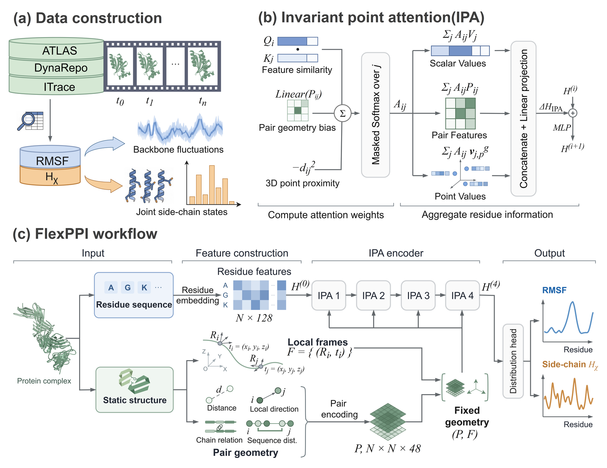

# FlexPPI

FlexPPI predicts two measures of flexibility for each residue in a protein or protein complex from a single PDB structure. **Cα root-mean-square fluctuation (RMSF, Å)** describes how much the backbone moves around its mean position. **Side-chain joint-state entropy (Hχ, nats)** describes how broadly the side chain samples different combinations of torsion angles. Both predictions use the geometry of the surrounding residues, including those on partner chains.

## Quick start

The repository includes five trained models and a backbone-only example from the crystal structure of ubiquitin bound to the UBA domain of the EDD ubiquitin ligase. From a Python 3.9+ environment, run the following commands to predict flexibility for ubiquitin (chain A) with the UBA domain (chain B) present in the input. [PDB entry 2QHO](https://www.rcsb.org/structure/2QHO) · [Structure report](https://doi.org/10.1074/jbc.M705655200)

```bash
git clone --depth 1 https://github.com/zeranhub/FlexPPI.git
cd FlexPPI
python -m pip install --upgrade pip
python -m pip install .
python -m flexppi predict --pdb examples/2qho_ab.pdb --target-chains A --output predictions.csv
```

For this example, `predictions.csv` contains 72 rows. Each row identifies a residue by chain, PDB residue number and amino acid, and gives the five-model mean in `rmsf_angstrom` and `chi_entropy_nats`. The Hχ field is empty for alanine and glycine, which have no side-chain χ angle. To analyze another complex, supply its PDB file with all relevant partner chains present. Omit `--target-chains` to report predictions for all chains.

## Training data

The dataset contains residue-level MD labels for 3,063 structures. The release archive includes all labels, 2,859 prepared structures, both five-fold partitions and input checksums. One command retrieves the remaining 204 DynaBench structures from DynaRepo. [Download the training data](https://github.com/zeranhub/FlexPPI/releases/download/training-data-v1/flexppi-training-data-v1.zip) · [Set up the dataset](study/README.md#download-the-training-data)

Raw trajectories are available from the original databases. [ATLAS](https://www.dsimb.inserm.fr/ATLAS/download.html) · [DynaRepo](https://dynarepo.inria.fr/) · [ITrace](https://itrace.life/download.html)

## Model

FlexPPI builds a local coordinate frame from each residue’s N, Cα and C atoms. Four invariant point attention layers combine amino acid identity with distances and orientations within and across chains. Training uses molecular dynamics (MD) trajectories as the reference for both outputs. To measure Hχ, each side-chain χ angle is assigned to one of three 120° bins. A residue that visits several combinations of bins with similar frequencies has higher entropy than one that spends most of its time in a single state.



## Evaluation

The study used five-fold cross-validation on 3,063 structure–trajectory records from ATLAS, DynaRepo and ITrace. Records from the same biological system stayed together. Average precision measures how well the model ranks residues at or above the 90th percentile of the corresponding MD measurement within each record.

| Predicted quantity | Mean absolute error | Average precision |
| --- | ---: | ---: |
| Backbone Cα RMSF | 0.577 Å | 0.730 |
| Side-chain Hχ | 0.166 nats | 0.926 |

The ubiquitin–UBA case illustrates why both outputs are useful. Two glutamines with similar backbone motion in MD (0.49 and 0.47 Å) have different side-chain entropies (3.01 and 1.89 nats). The held-out model predicted 2.99 and 2.00 nats at those sites. [Ubiquitin profiles](study/README.md#ubiquitin-case-study) · [Benchmark figure and tables](study/README.md#benchmark-tables) · [Training and fold assignments](study/README.md)

**Manuscript in preparation for submission.** The FlexPPI source code is distributed under the Apache License 2.0. [License](LICENSE) · [Attribution](NOTICE)
