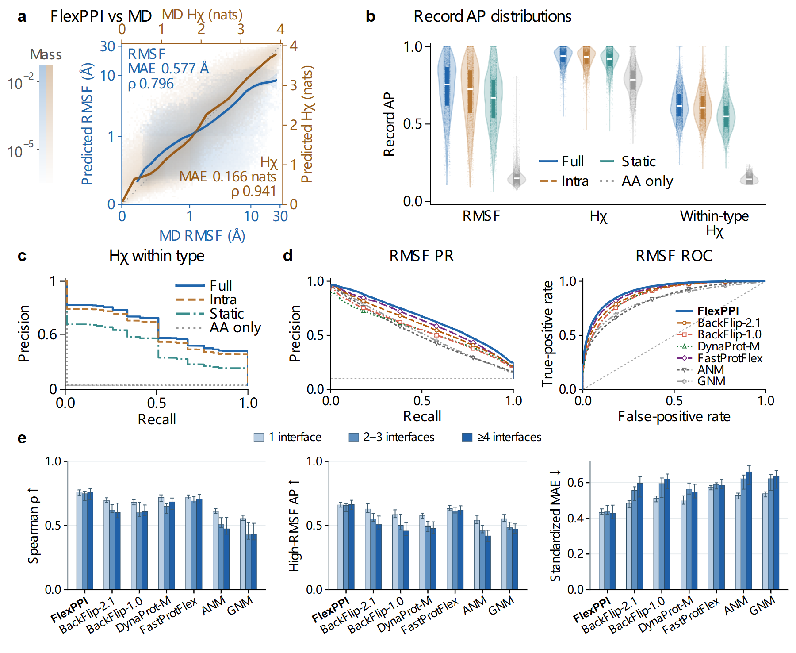
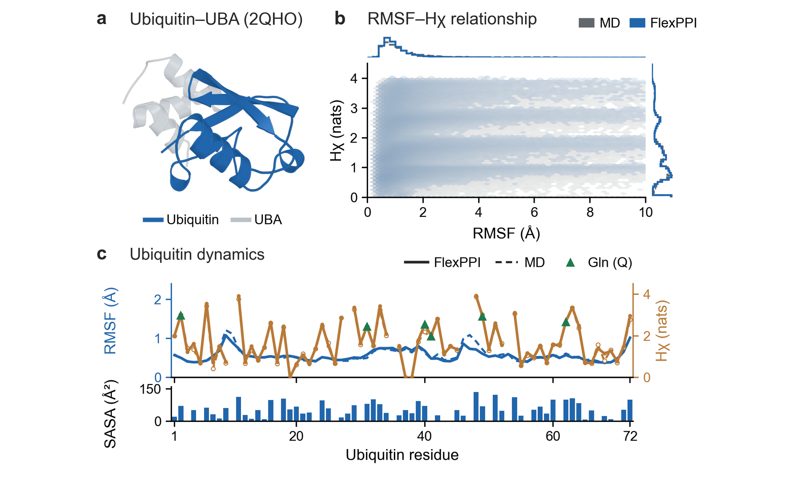

# FlexPPI

**Joint prediction of backbone and side-chain flexibility in protein complexes**

Two residues can show nearly identical backbone motion while their side chains explore different conformations. FlexPPI predicts both quantities from a single protein structure. For each residue, it estimates **Cα root-mean-square fluctuation (RMSF, Å)**, the displacement of the backbone Cα atom around its mean position after alignment, and **side-chain joint-state entropy (Hχ, nats)**, which measures how broadly the side chain samples combinations of torsion angles. Molecular dynamics (MD) trajectories provide the reference measurements for training and evaluation.

The model reads amino acid identities, backbone coordinates and chain assignments from a PDB file. It builds a local coordinate frame from each residue’s N, Cα and C atoms. Four invariant point attention layers then combine information from residues on the same chain and from neighboring residues on partner chains. During training, each observed side-chain χ angle is assigned to one of three 120° bins. The frequencies of the resulting combinations define Hχ. A side chain that occupies several combinations evenly has higher entropy than one concentrated in a single state.


## Predict flexibility from a PDB structure

The repository includes five trained models and a backbone-only example from the crystal structure of ubiquitin bound to the UBA domain of the EDD ubiquitin ligase. From a Python 3.9+ environment, run the following commands to predict flexibility for ubiquitin (chain A) with the UBA domain (chain B) present in the input. [PDB entry 2QHO](https://www.rcsb.org/structure/2QHO) · [Structure report](https://doi.org/10.1074/jbc.M705655200)

```bash
git clone --depth 1 https://github.com/zeranhub/FlexPPI.git
cd FlexPPI
python -m pip install --upgrade pip
python -m pip install .
python -m flexppi predict --pdb examples/2qho_ab.pdb --target-chains A --output predictions.csv
```

For this example, `predictions.csv` contains 72 rows. Each row identifies a residue by chain, PDB residue number and amino acid, and gives the five-model mean in `rmsf_angstrom` and `chi_entropy_nats`. The Hχ field is empty for alanine and glycine, which have no side-chain χ angle. To analyze another complex, supply its PDB file with all relevant partner chains present. Omit `--target-chains` to report predictions for all chains.

## Performance against molecular dynamics

The study evaluated 3,063 structure–trajectory records from ATLAS (1,929), DynaRepo (890) and ITrace (244). In five-fold cross-validation, records from the same biological system stayed together, and each record was predicted by the model that held out its fold. The table gives the mean absolute error and the average precision for identifying residues at or above the 90th percentile of the corresponding MD measurement within each record.

| Predicted quantity | Mean absolute error | Average precision |
| --- | ---: | ---: |
| Backbone Cα RMSF | 0.577 Å | 0.730 |
| Side-chain Hχ | 0.166 nats | 0.926 |

Side-chain flexibility also varies among residues of the same amino acid type. When sites were ranked separately within each amino acid type and record, FlexPPI achieved an average precision of 0.623, compared with 0.146 for the amino acid type baseline. Panels d and e compare RMSF predictions on the 615 multichain DynaRepo records. [Fold assignments, benchmark tables and training configurations](study/README.md)



## Reading the two profiles together

In ubiquitin chain A, glutamines 2 and 41 have similar Cα fluctuations in MD (0.49 and 0.47 Å), yet their side chains occupy different ranges of conformations. MD gives Hχ values of 3.01 and 1.89 nats at these sites. The held-out fold 0 model gave the same ordering on the study input (DynaRepo record A003R), predicting 2.99 and 2.00 nats. Panel c shows these sites alongside the other four glutamines in the chain. Panel b places this example in the wider cohort, showing the joint distribution across 824,988 positions with both MD measurements. [Residue profiles](study/ubiquitin/profiles.csv) · [Solvent-accessible areas](study/ubiquitin/solvent_accessibility.csv)



**Manuscript status** · In preparation for submission. The FlexPPI source code is distributed under the Apache License 2.0. [License](LICENSE) · [Attribution](NOTICE)
